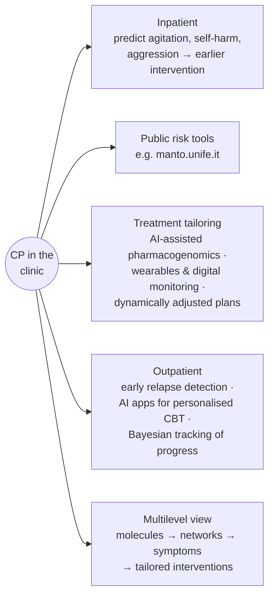
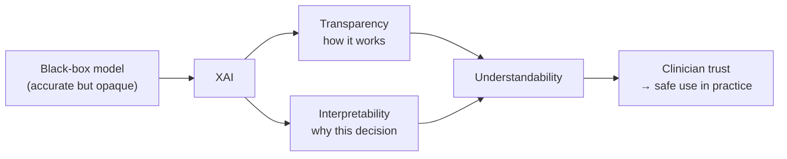
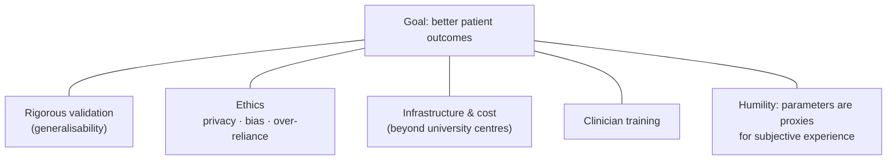

# Clinical Use: Promises, Challenges and Explainable AI

Back to [[00. Computational Psychiatry - Research Home|Research Home]] · Previous: [[12. Machine Learning Applications in Psychiatry]] · Source: [[01. Paper - What is Computational Psychiatry (Antonucci 2026)|Antonucci 2026]], "Integrating Computational Psychiatry into Clinical Practice" and "Conclusions", pp. 8–10

## Care settings
- **Inpatient**: the patient is admitted to hospital.
- **Outpatient**: the patient lives at home and visits a clinic.

The paper says CP "might have notable implications" in both (p. 8).

## Promises

> [!quote] From the paper (pp. 8–9)
> 1. **Risk prediction in hospitals.** Predictive models can identify people at heightened risk of **agitation, self-harm or aggression**, which allows earlier interventions (ref. 88).
> 2. **Public risk tools.** Models built from available data can be released as **public tools** to identify people with a higher probability of developing **psychopathology** (mental disorder). The paper's example is **https://manto.unife.it**.
> 3. **Medication.** "AI-assisted **pharmacogenomics** has shown effectiveness in tailoring medication adjustments for optimized treatment and reduced side effects" (ref. 89). *Pharmacogenomics* studies how a person's genes affect their response to drugs.
> 4. **Real-time monitoring.** **Wearable sensors and digital monitoring tools** provide real-time patient data that can inform **dynamically adjusted treatment plans** (ref. 90).
> 5. **Outpatient tools** for **early relapse detection** in mood disorders and psychosis. A *relapse* is when symptoms return after improvement.
> 6. **AI-driven mental health apps** can deliver **personalised cognitive-behavioural therapy (CBT)**. CBT is a talking therapy that changes unhelpful thoughts and behaviours.
> 7. **Bayesian modelling techniques** let clinicians refine therapy based on patient progress.
> 8. **Multilevel characterisation.** Computational approaches let clinicians describe patients "across multiple levels, from molecular and neurophysiological processes to network dynamics and observable symptom dimensions", supporting "more precise and individually tailored intervention strategies" (ref. 91).

> [!warning] Citation mismatch to check
> The pharmacogenomics claim (point 3) cites ref. 89, whose title is *"Computational medication regimen for **Parkinson's disease** using **reinforcement learning**"*. By its title, that is neither pharmacogenomics nor psychiatry. Points 5–7 (relapse detection, CBT apps, Bayesian therapy refinement) have **no citation**. Treat these as the authors' claims and verify them before using them in your own writing. See [[15. Source Issues and Open Questions]].

## Challenges and limitations

> [!quote] From the paper (p. 9)
> "However, **enthusiasm should be tempered** by some limitations."

### 1. Generalisability
Computational models face **the same generalisability challenges** as traditional statistical models (ref. 93). Clinical implementation needs **continuous validation, up-to-date studies**, and **digital knowledge** to use the tools well (ref. 94). *Generalisability* means the model still works on new patients, hospitals or populations; see overfitting in [[04. What is a Model]].

### 2. Causality and "black boxes"
AI and ML algorithms are "**not necessarily causally valid**" (ref. 95). They are often seen as less interpretable **"black boxes"**, and this "might prove crucial" for their future use in psychiatry.

### 3. Usability and trust
> [!quote] From the paper (p. 10)
> "Especially in the field of mental health, the **usability and reliability of AI tools need to be carefully and continuously assessed**: they should **assist clinicians and not introduce further complexity**; in order to be trustworthy, their limits should be rigorously verified and clarified."

### 4. Explainable AI (XAI): the proposed fix for black boxes

> [!quote] From the paper (p. 10)
> "In recent years, the concept of **explainable AI ('XAI')** emerged as an additional possibility to narrow the gap between the algorithms and the clinicians." Clinicians "need to understand how AI models reach their conclusions in order to trust and effectively use them", especially given the **probabilistic and multifactorial** nature of psychiatric data (many uncertain, interacting causes).

XAI has two parts, which together support **human understandability** (ref. 97):

| Concept | Paper's definition |
|---|---|
| **Transparency** | *How the model works* |
| **Interpretability** | *How to understand its decisions* |

By improving both, XAI "supports **safer, more effective, and clinician-friendly** AI tools in mental health care."

> [!info] Extra context (not from the paper)
> Common XAI techniques include **SHAP** and **LIME** (which features pushed a prediction up or down), **saliency maps** (which parts of a brain image a CNN focused on), and inherently interpretable models such as decision trees. The paper names no specific XAI technique.

> [!tip] Link to theory-driven models
> Theory-driven parameters such as the learning rate α are **interpretable by design**, since each one has a psychological meaning. This is one reason the paper values combining both approaches ([[03. Theory-driven vs Data-driven Approaches]]). The connection is my own; the paper doesn't state it in the XAI section.

### 5. Cost, infrastructure, skills and access
> [!quote] From the paper (p. 10)
> - Implementation "often comes with **significant costs**, requiring specialized infrastructure and training".
> - Clinicians may need **extra knowledge and skills** to interpret model outputs.
> - Integrating tools into **existing clinical workflows** poses logistical challenges.
> - Example: collecting huge amounts of data for AI may at first be feasible **only in university centres**, which reduces how widely results can be applied and accessed.
> - **Equitable access** and **algorithmic bias** are "crucial considerations for responsible implementation".

*Algorithmic bias*: a model performing worse or unfairly for some groups, often because they were under-represented in its training data.

## Conclusions of the paper

> [!quote] From the paper (p. 10)
> "Computational psychiatry is a transformative approach that seeks to revolutionize mental health care by **integrating neuroscience, mathematical models, and clinical practice**."
> - **Theory-driven** approaches, grounded in established scientific principles, build models to **explain the mechanisms** behind mental processes and behaviours.
> - **Data-driven** methods use vast datasets and ML to **uncover patterns and predict clinical risks and outcomes**.

### What responsible progress requires (p. 10)
1. **Ethical, infrastructure and generalisability frameworks** that address:
   - **data privacy**,
   - **algorithmic bias**,
   - the potential for **over-reliance on automated systems**.
2. Awareness of **inherent limitations**:
   - "the parameters are **mathematical proxies** that may inadequately capture the **subjective dimensions** of mental disorders";
   - "even sophisticated models risk **oversimplifying** phenomena that may be **irreducibly biological, psychological, and social** in nature" (refs. 98, 99).
3. **Training initiatives** so clinicians have the background to use computational models effectively.
4. **Continued research, rigorous validation and ongoing ethical oversight**, to improve patient outcomes and advance mental health treatment.

## Related
- What ML has achieved: [[12. Machine Learning Applications in Psychiatry]]
- Why overfitting threatens generalisability: [[04. What is a Model]]
- Problems found in this section: [[15. Source Issues and Open Questions]]
